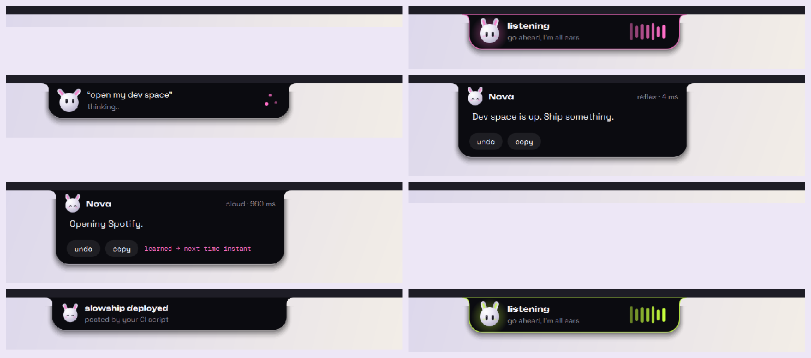
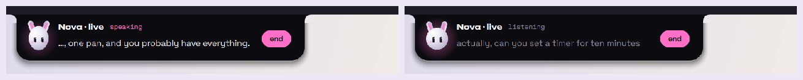
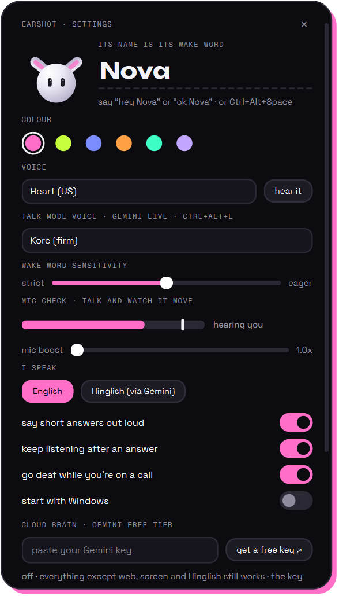

# earshot

**An always-on voice assistant that lives in a Dynamic Island at the top of your Windows screen.**

Say its name and it opens your whole workspace, runs your routines, rewrites the text you've selected in any app, answers with live Google results, or just sets a timer. Everyday commands are handled on your laptop in milliseconds. The cloud steps in only when it has to, and anything it works out once becomes instant the next time.

Its name is its wake word, and you choose it. Rename it in settings, or say *"call yourself Pixel"*, and it answers to the new name straight away. No training needed.



  

## Contents

[Quick start](#quick-start) · [What it does](#what-it-does) · [Things to say](#things-to-say) · [Talk mode](#talk-mode) · [Make it yours](#make-it-yours) · [Privacy](#what-leaves-your-laptop) · [Troubleshooting](#when-it-doesnt-answer) · [How it works](#how-it-works) · [Limits](#honest-limits) · [Credits](#credits-and-licences)

## Quick start

1. Install **Python 3.11 or newer** from [python.org](https://www.python.org/downloads/windows/), and tick *Add python.exe to PATH*. (Avoid the Microsoft Store Python: Windows gives Store apps a private copy of AppData, which hides your settings.)
2. Download this repo (green **Code** button, then *Download ZIP*, then unzip) or `git clone` it.
3. Double-click **`setup.bat`**. It makes a private Python environment in `.venv`, installs the packages, and downloads the voice models (about 900 MB, once).
4. Double-click **`start.bat`**. The island appears at the top of your screen.
5. Say **"hey Nova, what time is it?"**

Optional, but worth it:
- **[Ollama](https://ollama.com)**, then `ollama pull gemma4:e2b` (4.6 GB). This is the on-device brain for odd phrasings and offline answers. `setup.bat` offers to fetch it if Ollama is installed.
- **A free Gemini key** from [AI Studio](https://aistudio.google.com/apikey), pasted into settings. It unlocks live web answers, reading your screen, Hinglish, and talk mode. Without it, everything else still works.
- **Start with Windows**: turn it on in settings.

| You need | Notes |
|---|---|
| Windows 10 (1703+) or 11, x64 | Developed and tested on Windows 11 |
| Python 3.11 – 3.13 | From python.org (3.12 and 3.13 tested) |
| About 1.5 GB of disk | Voice models plus packages; Gemma adds 4.6 GB |
| A microphone | Any built-in or USB mic. Auto-gain handles quiet ones |
| Speakers or headphones | Optional: answers also show on the island |

## What it does

**Hears you**
- *"Hey Nova, …"*, *"ok Nova, …"* or just *"Nova, …"*.
- **Two ways to wake, both checked by Parakeet** (a speech-to-text model), so accents and quiet mics get through:
  - A fast spotter fires mid-sentence, and Parakeet confirms the name was really said.
  - Every short phrase also goes to Parakeet: if it starts with the name, it wakes, and the rest of the phrase is the command.
- **Auto-gain** lifts a quiet mic up to 12×.
- Measured with five synthetic voices (two of them Indian-English) in [`tests/voice_matrix.py`](tests/voice_matrix.py): **58–60 of 60 spoken commands reached the right action** (the synthetic voices vary a little from run to run), and **0 of 33 other sentences woke it** ("hey Siri", "hey Noah", "I bought novels"…).
- **Follow-ups.** For about 5 s after an answer, you can reply without the name. Its own echo is ignored.
- **Calls.** It goes deaf on its own while another app records from a mic (Discord, Meet, Teams), and names that app on the island. Apps that always hold the mic, like Voicemod, don't count.
- **Hotkeys.** **Ctrl+Alt+Space**: talk without the name. **Ctrl+Alt+K**: type instead. **Ctrl+Alt+L**: talk mode.

**Thinks in three tiers, cheapest first**

| tier | what | speed |
|---|---|---|
| reflex | rules plus phrases it has learned | 0.1 – 10 ms |
| on-device | Gemma 4 E2B through Ollama: picks one of 20 tools from odd phrasing | 0.2 – 0.6 s (warm) |
| cloud | Gemini free tier: questions, writing, web search, your screen, MCP tools | about 1 s |

- Every answer card shows which tier answered and how long it took.
- **It gets faster as you use it.** When Gemini turns a phrase into one simple action and you don't undo it, the phrase becomes a reflex: instant and offline next time. Only Gemini's answers are learned, so a small model's slip never sticks.
- **It never pretends.** If nothing understood you, it shows what it heard (*"I heard 'War's time'. Say it again?"*). It never claims an action it didn't take.

**Does things Windows can't**
- **Workspaces that really restore.**
  - *"Open dev space"* launches VS Code in your project, a terminal and GitHub, snaps every window into place, and puts it all on its own virtual desktop.
  - *"Close dev space"* closes exactly those windows and that desktop.
  - *"Remember this as hackathon"* saves the windows you have open now, including VS Code folders, Explorer folders and positions.
  - *"Where was I?"* restores the setup it auto-saves every 10 minutes.
- **Rewrite anything, anywhere.** Select text in any app and say *"make this formal"*, *"fix the grammar"* or *"translate to Hindi"*. It's replaced in place, and *"undo"* puts it back.
- **"This" means what you're looking at.** *"Explain this"* reads your selection. With nothing selected, it looks at your screen, and the island tells you before anything is sent.
- **Undo for real actions:** volume, opened apps, workspaces, rewrites, renames, timers.
- **Memory:** *"remember that my college folder is D:\College"*. Every brain sees the facts you've told it.
- **Timers on the island** with a countdown ring, a chime and a spoken *"time's up"*.
- **Game mode:** a fullscreen game or video tucks the island away and frees the GPU.
- **Anything can post to the island:** `python -m earshot notify "Build done" "deployed to prod"` from CI, a script or a Stream Deck.


## Things to say

| you say | it does |
|---|---|
| open dev space · close dev space · where was I · remember this as hackathon | workspaces |
| open Spotify · switch to Chrome · close Discord · open downloads · open youtube.com | apps, windows, folders, sites |
| volume to 30 · turn it way down · mute · next song · pause | sound and media |
| set a 10 minute timer for pasta · remind me in 20 minutes to call mom · cancel timers | timers |
| play lofi on YouTube · search mechanical keyboards on Amazon | web search in your browser |
| what's the weather in Pune · who won the match | live Google answer (Gemini) |
| make this sound formal · translate this to Hindi · explain this · what's on my screen | your selection or screen |
| remember that … · what do you know about me · forget … | memory |
| what time is it · how much battery · take a screenshot · lock the screen · show desktop | system |
| pomodoro · good night · good morning | the example skills |
| let's talk · can we chat for a bit | talk mode |
| call yourself Pixel · stop listening · undo · never mind | itself |

Polite openers like *"can you…"* and *"please…"* are fine. In Hinglish mode, *"dev space khol do"* and *"awaaz kam karo"* work too.

## Talk mode

*"Let's talk"*, **Ctrl+Alt+L**, or **live talk** on the island starts a free-form conversation with Gemini Live in native audio.
- **You can interrupt it** mid-sentence, and it stops at once.
- **It keeps every tool** (*"…and open my dev space"*) and searches Google itself.
- **Live captions** for both of you sit on the island.
- **Ending:** say *"bye"*, click **end**, or stay quiet for 45 s.
- **A dropped connection resumes** where you were. Pick its voice in settings.



On laptop speakers, a loudness gate keeps it from hearing itself, so speak up to interrupt it. With headphones you can interrupt at any volume.

## Make it yours

Everything lives in `%APPDATA%\earshot`. The settings panel has buttons that open each folder.



**Settings** (click the island, then **settings**):
- name and colour;
- Kokoro voice for replies, and Gemini Live voice for talk mode;
- wake sensitivity, with a live **mic check** that flashes "heard my name";
- mic boost, English or Hinglish, spoken replies, follow-ups, pausing during calls, start with Windows;
- Gemini key (stored in Windows Credential Manager) and the Ollama model.

**Workspaces** live in `workspaces\*.toml`. See [`dev.toml`](earshot/examples/workspaces/dev.toml) for every option:

```toml
name = "dev"
phrases = ["coding", "work"]      # "open coding space" works too
desktop = "new"                    # its own virtual desktop ("current" = right here)
close = ["Discord"]                # distractions to close first

[[apps]]
run = "code"                       # any command on PATH or full path to an .exe
args = ["~/Documents/my-project"]
place = "left-two-thirds"          # left, right, top-left … thirds, full, or [x, y, w, h]

[[apps]]
url = ["https://github.com", "https://dev.to"]    # one browser window, a tab each
place = [0.667, 0.5, 0.333, 0.5]
```

**Skills** live in `skills\*.toml`: trigger phrases plus steps. A step is any tool with its arguments, a shell command (`run = "..."`), or a pause. See [`study-sprint.toml`](earshot/examples/skills/study-sprint.toml):

```toml
name = "study sprint"
phrases = ["pomodoro", "lock in"]
reply = "Locked in. 25 minutes, go."

[[steps]]
tool = "close_app"
name = "Discord"

[[steps]]
tool = "timer"
minutes = 25
label = "focus sprint"
```

**MCP servers:** every tool of every server you add becomes the assistant's (through the cloud brain and talk mode). Add them to `settings.json`:

```json
"mcp": { "files": { "command": "npx.cmd", "args": ["-y", "@modelcontextprotocol/server-filesystem", "C:/Users/you/Documents"] } }
```

**Your scripts** can talk to it at `http://127.0.0.1:7878`:

| | |
|---|---|
| `POST /notify` `{"title", "text"}` | a toast on the island |
| `POST /ask` `{"text"}` | do it as if you'd said it; returns the answer |
| `POST /selftest` `{"text", "volume"}` | speak a phrase into its ears (see troubleshooting) |
| `GET /ping` | name, and what the ears are doing |

POST requests need the header `X-Earshot-Token`, set to the contents of `%APPDATA%\earshot\token`, so web pages can't drive your PC. From a terminal: `python -m earshot notify …`, `ask …`, `selftest …`, `autostart on|off`.

**New powers** are one Python function: add it to [`earshot/hands.py`](earshot/hands.py) with `@tool()` and a docstring. All three brains can use it immediately.

## What leaves your laptop

- **Never:**
  - audio before the wake word (it sits in a 1.6 s memory buffer and is never written anywhere);
  - phrases without the name (dropped right away: not logged, not kept);
  - anything handled by reflexes or Gemma.
- **To Gemini, only when that tier answers:** the text of your request, the title of the window you're in, your saved facts, and the last few turns.
  - Your screen or selection goes only for *"explain this"*-style requests, and the island says so first.
  - In talk mode, your mic streams to Gemini Live until the conversation ends.
  - Google's free tier may use that content to improve its products.
- **On disk:**
  - `%APPDATA%\earshot` holds settings, learned phrases, your facts, and `earshot.log`.
  - The log has wake attempts, what it heard after waking, and errors. It's trimmed automatically.
  - The Gemini key lives in Windows Credential Manager.

## When it doesn't answer

1. **Is it listening?** Hover the island. It says "say 'hey Nova'", "hushed", or which app has the mic.
2. **Does it hear you?** In settings, watch **mic check** while you talk.
   - If the bar barely moves, raise **mic boost**, or the mic level in Windows sound settings. This matters more than anything else for strong accents.
   - If it says "heard my name!" but nothing happens, read the log.
3. **Read the log.** `%APPDATA%\earshot\earshot.log` shows every wake attempt: what the spotter caught, what Parakeet heard (*"phrase starts with 'hey david': not the name"*), what it did, and full stack traces if anything fails.
4. **Rule out the mic.** `python -m earshot selftest "hey Nova, what time is it"` speaks the phrase into the running app's ears with a synthetic voice. If that works and your voice doesn't, it's the mic, not the app.
5. **Start it yourself.** Use `start.bat`, or turn on *start with Windows*. Launched from inside another packaged app's terminal, Windows hands it that app's private AppData.

## How it works

```
mic ─▶ auto-gain ─▶ wake: spotter (sherpa-onnx KWS) ──┐
                     └─ phrases (Silero VAD) ─────────┴▶ Parakeet TDT v3 checks the name, then transcribes you
     ─▶ brain: reflex rules + learned phrases ─▶ Gemma 4 E2B (Ollama) ─▶ Gemini (+ Google Search, MCP)
     ─▶ hands: 32 tools (apps, windows, workspaces, volume, timers, clipboard, skills …), most with undo
     ─▶ island (PySide6 + QPainter) + Kokoro voice · talk mode: mic ⇄ Gemini Live, same tools
```

| file | what |
|---|---|
| [`earshot/ears.py`](earshot/ears.py) | auto-gain, both wake paths, VAD, speech-to-text, call detection |
| [`earshot/brain.py`](earshot/brain.py) | the tiers, rules, memory, learning, Gemini, MCP |
| [`earshot/hands.py`](earshot/hands.py) | every tool: one function each |
| [`earshot/island.py`](earshot/island.py) | the island, the creature, the type box, settings |
| [`earshot/voice.py`](earshot/voice.py) | Kokoro, streamed sentence by sentence |
| [`earshot/live.py`](earshot/live.py) | talk mode: barge-in, tool calls, resumption, echo gate |
| [`earshot/__main__.py`](earshot/__main__.py) | wiring, hotkeys, the local endpoint, the log |

**Checks** (run them with the `.venv` Python):

| command | what it covers |
|---|---|
| `tests\check.py --ears` | 36 phrasings through the rules, 10 odd phrasings through the rules or Gemma, and 4 spoken commands through the real wake-word and speech-to-text path |
| `tests\voice_matrix.py` | 60 spoken commands in 5 voices, and 33 sentences that must not wake it |
| `tests\live_check.py --net` | talk mode against a scripted fake Gemini Live server: resumption, captions, barge-in, tool ids, "bye". Also the echo gate, the speaker buffer, and a bad key against Google's real server |
| `tests\shots.py` | renders every island state, as in the pictures above |

## Honest limits

- **The wake word** was tuned on synthetic voices plus one real (Indian-English) voice in one room. A strong accent through a quiet mic still makes Parakeet mishear sometimes (it once heard "hey Jarvis" as "hey david"). Raising the Windows mic level helps most.
- **Gemma 4 E2B** misses indirect requests like "it's way too loud in here". Those go to Gemini, or get an honest "say it again".
- **Speed versus idle CPU:**
  - Parakeet and Kokoro run on one thread each. With more threads, ONNX Runtime keeps its extra threads spinning forever (4 threads left 63% of a core busy while idle).
  - The cost: about 0.4 s to understand a command, and about 2.4 s before it starts speaking. The text shows on the island at once.
- **Resources:** about 1.1 GB of RAM (the models stay loaded), and about 14% of one CPU core while idle in a room where people talk.
- **Talk mode on speakers** uses a loudness gate, not echo cancellation, and hasn't had long real-world conversations yet.
- **"Remember this as…"** reopens browser windows, but not their tabs.
- **Not built yet:** an "only my voice" speaker lock, an installer, code signing.
- **Tested on** Windows 11 x64, with Python 3.12 and with Python 3.13 in a fresh clone set up by `setup.bat`. The full test suite passed on both. Windows 10 and ARM64 are untested.

## Credits and licences

earshot is MIT-licensed ([LICENSE](LICENSE)). It stands on:

| | licence |
|---|---|
| [sherpa-onnx](https://github.com/k2-fsa/sherpa-onnx): wake word, VAD, speech-to-text and speech engines | Apache-2.0 |
| [NVIDIA Parakeet TDT 0.6B v3](https://huggingface.co/nvidia/parakeet-tdt-0.6b-v3): speech-to-text | CC-BY-4.0 |
| [Kokoro-82M](https://huggingface.co/hexgrad/Kokoro-82M): voice | Apache-2.0 |
| [Silero VAD](https://github.com/snakers4/silero-vad) | MIT |
| [Gemma 4](https://ai.google.dev/gemma) via [Ollama](https://ollama.com) | Gemma terms |
| [Gemini API](https://ai.google.dev): cloud brain and talk mode | Google terms |
| [PySide6](https://doc.qt.io/qtforpython-6/) | LGPL-3.0 |
| [Unbounded](https://github.com/googlefonts/unbounded), [Space Grotesk](https://github.com/floriankarsten/space-grotesk), [Geist Mono](https://github.com/vercel/geist-font) | OFL-1.1 (in `earshot/fonts`) |
